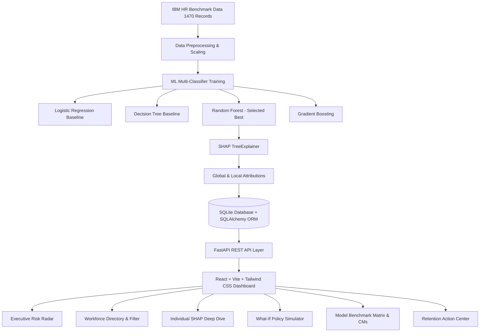

# Explainable Predictive Analytics for Employee Attrition Risk Assessment
### An Explainable AI (XAI) & HR Decision-Support Framework Powered by ML and SHAP

**Institution:** Department of Computer Science and Information Technology, Koneru Lakshmaiah Education Foundation (KLEF / KL University)  
**Course:** Applied Machine Learning (Course Code: `24ALT3101`)  
**Project Guide / Supervisor:** Dr. K. SWANTHANA  
**Team Number:** 15  

| Roll Number | Student Name | Role |
| :--- | :--- | :--- |
| **2420030082** | **Y MANIKANTA SAI** | Team Lead, ML Pipeline & System Architecture |
| **2420030083** | **D SAI SRUJAN** | Explainable AI (SHAP) & Data Preprocessing |
| **2420040098** | **GOLLA RAHUL** | Backend REST API, Database & What-If Engine |
| **2420090054** | **BOYA VINAY** | Frontend Dashboard, UI/UX & Documentation |

---

## 📁 Repository Structure

```
├── data/
│   ├── attrition_data.csv          <- Benchmark IBM HR dataset (1,470 records, 35 attributes)
│   ├── attrition_system.db         <- Seeded SQLite database with predictions & SHAP attributions
│   ├── data_dictionary.md          <- Complete feature catalog, data types & value ranges
│   └── README.md                   <- Data provenance, partitioning & ethical boundaries
│
├── doc/
│   ├── alt ppt 1 review.pptx       <- Milestone review presentation deck 1
│   ├── alt ppt 2.pptx              <- Comprehensive review presentation deck 2
│   ├── EPAEA_Project_Abstract.pdf  <- Research abstract formatted for university submission
│   ├── EPAEA_Project_Documentation.pdf <- Official 9-page university project documentation
│   ├── EPAEA_Research_paper.pdf    <- Full academic research paper manuscript
│   ├── Explainable_Predictive_Analytics_Employee_Attrition.pptx <- Capstone defense presentation
│   ├── mini hackathon 1 alt.docx   <- Mini-Hackathon 1 design documentation
│   └── mini hackathon 2 alt.docx   <- Mini-Hackathon 2 prototype documentation
│
├── reports/
│   ├── EPAEA_Project_Abstract.pdf  <- Research abstract formatted for university submission
│   ├── EPAEA_Research_paper.pdf    <- Full academic research paper manuscript
│   ├── Research_Paper_Abstract.md  <- Complete research abstract with credentials & keywords
│   ├── Model_Performance_Report.md <- Comprehensive model evaluation, CMs & precision-recall analysis
│   ├── Literature_Survey_and_Gap_Analysis.md <- Academic literature survey & research gap synthesis
│   └── README.md                   <- Guide to research reports
│
├── results/
│   ├── metrics.json                <- Machine-readable benchmark evaluations for all 4 models
│   ├── confusion_matrices.json     <- Structured 2x2 confusion matrices (TN, FP, FN, TP)
│   ├── shap_global_importance.json <- Global SHAP feature importance rankings
│   ├── shap_global_importance.csv  <- Tabular global SHAP rankings
│   ├── benchmark_summary.md        <- Empirical results comparison table (Table XIII)
│   └── README.md                   <- Empirical findings summary
│
├── src/
│   ├── backend/                    <- FastAPI REST API microservice, SQLAlchemy ORM & ML pipeline
│   │   ├── api/                    <- Route handlers (employees, models, retention, simulate, stats)
│   │   ├── data/                   <- Local data files
│   │   ├── database/               <- SQLite connection & database schemas
│   │   ├── ml/                     <- Training scripts & saved models (Random Forest, SHAP explainer)
│   │   └── requirements.txt        <- Python dependencies
│   ├── frontend/                   <- React 19 + Vite + Tailwind CSS Single Page Application
│   │   ├── src/                    <- Components (Dashboard, Explorer, Modal, What-If, Benchmark)
│   │   ├── public/                 <- Icons and SVG assets
│   │   └── package.json            <- Node package dependencies
│   └── README.md                   <- Source code execution guide
│
├── .gitignore                      <- Clean Git exclusion rules
├── README.md                       <- Master project repository overview
└── start_servers.bat               <- One-click launch script for both backend & frontend
```

---

## 📌 Executive Summary & Abstract

Employee attrition poses significant challenges to modern organizations by elevating recruitment and replacement overhead, disrupting established workflows, and eroding institutional knowledge. While machine learning classifiers can forecast turnover risk, conventional "black-box" implementations fail to expose why an employee is flagged, hindering responsible human-resource intervention.

This project delivers an **Explainable Predictive Analytics System for Employee Attrition Risk Assessment** combining supervised machine learning, SHAP (SHapley Additive exPlanations) interpretability, and a full-stack decision-support platform. Evaluated on the benchmark **IBM HR Analytics dataset (1,470 records, 35 attributes)** using an isolated 20% stratified test partition ($N = 294$), four architectures were benchmarked: **Logistic Regression, Decision Tree, Random Forest, and Gradient Boosting**.

**Random Forest** was selected as the deployed engine because it achieves an optimal balance between precision (45.24%), recall (40.43%), test accuracy (82.65%), and ROC-AUC (78.55%), alongside exact polynomial-time compatibility with SHAP `TreeExplainer`. The accompanying React and FastAPI web application features an Executive Risk Radar, a filterable Workforce Directory, individual SHAP waterfall attributions, a Counterfactual What-If Simulation Sandbox, and an Action Planning Tracker.

---

## 🏛️ System Architecture



---

## 📊 Held-Out Test Set Empirical Results (Table XIII)

| Model Architecture | Model Family | Test Accuracy | Precision | Recall | F1-Score | ROC-AUC | Status |
| :--- | :--- | :---: | :---: | :---: | :---: | :---: | :---: |
| **Logistic Regression** | Linear Classifier | 75.51% | 35.63% | **65.96%** | **46.27%** | 80.35% | Evaluated |
| **Decision Tree** | Single Tree | 77.21% | 35.71% | 53.19% | 42.74% | 65.17% | Evaluated |
| **Random Forest (Selected Best)** | Ensemble Bagging | **82.65%** | **45.24%** | **40.43%** | **42.70%** | **78.55%** | **Deployed Best** |
| **Gradient Boosting** | Ensemble Boosting | 85.03% | 57.89% | 23.40% | 33.33% | 81.46% | Evaluated |

*Evaluation details: 20% stratified holdout ($N = 294$, 247 negative non-turnover, 47 positive turnover), `random_state = 42`.*

---

## 🔍 Top 5 Global Workforce Risk Drivers (SHAP)

1. **OverTime (Yes):** `+0.0532` — Persistent overtime is the single most influential positive predictor of voluntary resignation.
2. **StockOptionLevel:** `+0.0372` — Absence of equity incentives (Tier 0 or 1) strongly elevates turnover propensity.
3. **Age:** `+0.0330` — Younger demographic cohorts show significantly higher market mobility and flight risk.
4. **MonthlyIncome:** `+0.0313` — Below-median base compensation relative to role demands acts as an immediate flight trigger.
5. **YearsWithCurrManager:** `+0.0272` — Long managerial tenure serves as a critical protective retention anchor.

---

## 💻 Interactive Application Features

- **Executive Risk Radar:** High-level overview of workforce turnover trends, department-level risk distributions, and historical benchmark baselines.
- **Workforce Directory:** Dynamic filtering across job roles, departments, overtime status, and calibrated risk tiers (Low $<30\%$, Medium $30-59\%$, High $\ge 60\%$).
- **Individual SHAP Deep Dive:** Granular waterfall breakdown showing the exact positive (risk-elevating) and negative (protective) drivers for each employee.
- **What-If Policy Simulator:** Interactive counterfactual sandbox allowing HR leaders to simulate the effect of compensation raises, overtime reduction, or equity adjustments in real time.
- **Retention Action Tracker:** Log and track customized HR interventions (workload rebalancing, career check-ins, retention bonuses) with audit notes.

---

## 🚀 Step-by-Step Installation & Execution Guide

### Prerequisites
- Python 3.10+
- Node.js 18+ and npm

### Option A: One-Click Startup (Windows)
Double-click `start_servers.bat` in the root directory. This launches both the FastAPI backend and React frontend concurrently.

### Option B: Manual Startup

#### 1. Backend (FastAPI + ML + SQLite)
```bash
cd src/backend
pip install -r requirements.txt
python -m uvicorn api.main:app --host 0.0.0.0 --port 8000 --reload
```
- API Documentation (Swagger UI): `http://localhost:8000/docs`
- Redoc Documentation: `http://localhost:8000/redoc`

#### 2. Frontend (React + Vite + Tailwind CSS)
```bash
cd src/frontend
npm install
npm run dev
```
- Interactive Web Dashboard: `http://localhost:5173`

---

## ⚖️ Responsible AI & Ethical Governance

In accordance with Section XVI of the research paper and IEEE AI ethics principles:
1. **Decision Support, Not Automated Action:** The system is an advisory tool to support proactive retention dialogue. It must **never** be used to automate termination, disciplinary actions, salary cuts, or promotion denials.
2. **Attribution Is Not Causation:** SHAP values represent statistical feature contributions within the fitted model; they do not prove that modifying a feature will guarantee an employee remains.
3. **Human-in-the-Loop Oversight:** Every algorithmic risk flag requires qualitative confirmation through confidential managerial check-ins and empathetic employee conversations.
4. **Data Privacy & Governance:** Employee data access must be restricted to authorized HR personnel and audited regularly.
