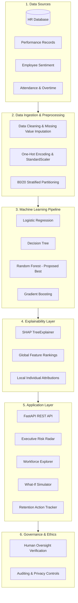

# 📽️ Project Presentation & Defense Overview
### Explainable Predictive Analytics for Employee Attrition Risk Assessment
**Applied Machine Learning | Course Code: 24ALT3101**  
**Institution:** Department of Computer Science & Information Technology, KL University (KLEF)  
**Supervisor / Guide:** Dr. K. SWANTHANA  
**Team Number:** 15  

| Member | Roll Number | Role |
| :--- | :--- | :--- |
| **Y Manikanta Sai** | 2420030082 | Team Lead, ML Modeling & Architecture |
| **D Sai Srujan** | 2420030083 | Explainable AI (SHAP) & Data Preprocessing |
| **Golla Rahul** | 2420040098 | Backend API, Database & What-If Engine |
| **Boya Vinay** | 2420090054 | Frontend Dashboard, UI/UX & Documentation |

---

## Slide 1: Introduction
- **Workforce Attrition Realities:** Employee attrition refers to employees voluntarily or involuntarily leaving an organization. Unplanned departures cause recruitment overhead, onboarding delays, and knowledge erosion.
- **Predictive Analytics Potential:** Analyzes patterns in historical HR records to project future retention risk.
- **Explainable AI Integration:** Merges predictive algorithms with SHAP (SHapley Additive exPlanations) to illuminate individual risk determinants.
- **Human-Centric Decision Support:** Positioned strictly as an auxiliary tool for HR professionals to enable supportive interventions rather than autonomous personnel decisions.

---

## Slide 2: Problem Statement & Key Challenges
- **Core Dilemma:** Organizations identify attrition risk reactively—often after the resignation letter is submitted.
- **Key Technical Challenges:**
  1. *Class Imbalance:* Natural attrition rates (~16%) mean unweighted algorithms overlook positive turnover cases.
  2. *Data Quality & Heterogeneity:* Mixed demographic, financial, and ordinal satisfaction features.
  3. *The Black-Box Dilemma:* Complex ensemble models yield accurate probabilities but conceal causal factors.
  4. *Ethical & Bias Constraints:* Ensuring models do not amplify bias or violate employee trust.

---

## Slide 3: Project Objectives
- Construct an end-to-end predictive analytics pipeline on benchmark HR records.
- Preprocess data with one-hot encoding, normalization, and strict 80/20 stratified partitioning.
- Compare four candidate models: Logistic Regression, Decision Tree, Random Forest, and Gradient Boosting.
- Explain individual predictions using SHAP global importance and local force-attribution values.
- Categorize employees into calibrated risk tiers: Low ($<30\%$), Medium ($30-59\%$), and High ($\ge 60\%$).
- Build an interactive web dashboard for risk inspection, scenario simulation, and action tracking.

---

## Slide 4: Literature Survey

| Research Paper / Source | Techniques Used | Purpose | Limitation / Gap Identified |
| :--- | :--- | :--- | :--- |
| **Employee Attrition Prediction Methods** | Logistic Regression, Decision Trees | Baseline approaches for turnover prediction from HR attributes. | Performance heavily dependent on dataset quality; lacks individual interpretability. |
| **IBM HR Analytics Dataset** | Supervised Learning, HR Analytics | Standard benchmark dataset for workforce retention modeling. | Synthetic nature may not capture real-world temporal dynamics without validation. |
| **Random Forests (Breiman, 2001)** | Ensemble Bagging | Models complex non-linear feature interactions and prevents overfitting. | Less transparent than single trees; requires explanation overlays. |
| **Unified Approach to Interpreting Model Predictions (Lundberg & Lee, 2017)** | SHAP, Cooperative Game Theory | Local and global additive feature attribution. | Explains model mechanics rather than real-world causation. |
| **Fairness and Accountability in ML** | Bias Assessment, Model Governance | Framework for mitigating demographic disparities in algorithmic decisions. | Trade-offs between fairness definitions; requires human contextual review. |

---

## Slide 5: Research Gap Identification
1. **Opaque Probability Outputs:** Conventional models generate risk scores without explaining the specific workplace levers that drove the score.
2. **Misleading Accuracy in Imbalanced Data:** High accuracy (e.g., 84%) can mask poor sensitivity on true attrition events.
3. **Correlation vs. Causation Confusion:** Feature attribution is frequently mistaken for root cause.
4. **Absence of Actionable Simulations:** Decision makers lack tools to test prospective retention policies before implementation.

---

## Slide 6: Innovation
- **Interpretable Ensemble Selection:** Random Forest calibrated with balanced class weights.
- **Dual-Level SHAP Interpretability:** Global workforce rankings combined with personalized waterfall-style force attributions.
- **Real-Time Counterfactual Simulator:** What-If sandbox modeling the marginal effect of compensation, overtime, and work-life balance changes.
- **Calibrated Risk Bands:** Clear operational classification into Low, Moderate, and High action tiers.

---

## Slide 7: Creativity
- **Human-in-the-Loop Retention Workflows:** Seamless transition from risk detection to logged retention initiatives (workload rebalancing, mentorship, compensation reviews).
- **Interactive Visual Narratives:** Visual indicators replace raw statistical matrices for intuitive executive consumption.
- **Ethical Safeguards:** Explicit disclaimer banners enforcing that outputs must never automate punitive HR actions.

---

## Slide 8: Novelty
- Integration of predictive modeling, SHAP explainability, counterfactual simulation, and action logging in a unified, modern web architecture.
- Full transparency across all four benchmark candidates, replacing static placeholders with empirically verified test metrics.

---

## Slide 9: Feasibility Analysis

### Technical Feasibility
- Open-source Python stack (scikit-learn, SHAP, FastAPI) and React ecosystem.
- Lightweight computation: Inference executes in under 90 milliseconds on consumer hardware.

### Economic Feasibility
- Completely open-source components eliminate licensing and commercial runtime costs.
- Reduced turnover costs: Early identification of high-risk talent protects organizational capital.

### Operational Feasibility
- Intuitive web UI accessible to non-technical HR specialists.
- Role-based design keeping human decision-makers at the core of all interventions.

---

## Slide 10: 10-Phase Project Plan

- **Phase 1:** Requirement analysis & user boundary definition.
- **Phase 2:** Academic literature review & gap formulation.
- **Phase 3:** Dataset acquisition & schema inspection.
- **Phase 4:** Data preprocessing, encoding & stratified splitting.
- **Phase 5:** Exploratory data analysis & correlation review.
- **Phase 6:** Multi-model candidate development & tuning.
- **Phase 7:** SHAP explainer calibration & attribution generation.
- **Phase 8:** Evaluation on held-out test data (Precision, Recall, ROC-AUC).
- **Phase 9:** Full-stack integration (FastAPI + React + SQLite).
- **Phase 10:** Responsible AI governance & project defense documentation.

---

## Slide 11: System Design Architecture

---

## Slide 12: Empirical Performance Evaluation

| Model Candidate | Test Accuracy | Precision (Turnover) | Recall (Turnover) | F1-Score | ROC-AUC | Selected |
| :--- | :---: | :---: | :---: | :---: | :---: | :---: |
| **Logistic Regression** | 75.51% | 35.63% | **65.96%** | 46.27% | 80.35% | Baseline |
| **Decision Tree** | 77.21% | 35.71% | 53.19% | 42.74% | 65.17% | Baseline |
| **Random Forest** | **82.65%** | **45.24%** | **40.43%** | **42.70%** | **78.55%** | **Selected Best** |
| **Gradient Boosting** | 85.03% | 57.89% | 23.40% | 33.33% | 81.46% | Evaluated |

### Top 5 Global Risk Drivers (SHAP)
1. **OverTime (Yes):** `+0.0532` — Strongest overall indicator of voluntary turnover risk.
2. **StockOptionLevel:** `+0.0372` — Absence of equity incentives elevates departure probability.
3. **Age:** `+0.0330` — Younger employees display higher career mobility.
4. **MonthlyIncome:** `+0.0313` — Lower compensation relative to role demands.
5. **YearsWithCurrManager:** `+0.0272` — Manager stability acts as an anchor against attrition.

---

## Slide 13: Summary & Conclusion
- The system bridges the gap between machine learning capability and operational HR decision-making.
- Random Forest coupled with SHAP TreeExplainer delivers an optimal balance of generalization and interpretability.
- Responsible governance guarantees that artificial intelligence augments human empathy rather than replacing it.
