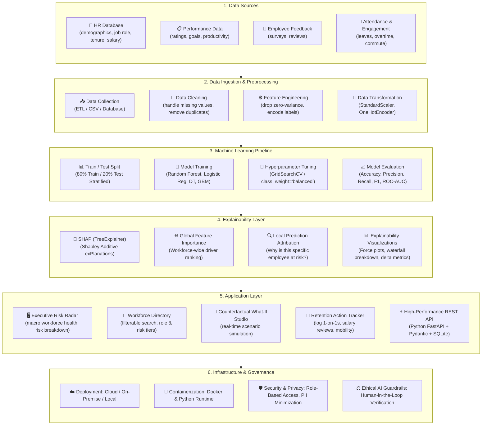

# 🏛️ System Design Architecture
### Explainable Predictive Analytics for Employee Attrition Risk Assessment
**From Data to Explainable Insights $\rightarrow$ Better Decisions $\rightarrow$ Higher Retention**

---

## Architecture Diagram

---

## Layer-by-Layer Detailed Specification

### 1. Data Sources Layer
- **Structured HR Database:** Tabular employee records containing 35 attributes (demographics, job level, salary, department).
- **Workplace Sentiment & Engagement:** Self-reported ratings on Job Satisfaction, Work-Life Balance, and Environment Satisfaction.
- **Tenure & Workload:** Recorded overtime hours, distance from home, years in current role, and duration under current reporting manager.

### 2. Data Ingestion & Preprocessing Layer
- **Cleaning & Filtering:** Deletion of static non-predictive columns (`StandardHours`, `EmployeeCount`, `Over18`, `EmployeeNumber`).
- **Feature Encoding:** Categorical string values (`BusinessTravel`, `Department`, `EducationField`, `Gender`, `JobRole`, `MaritalStatus`, `OverTime`) transformed via scikit-learn `OneHotEncoder(drop="first")`.
- **Scaling:** Continuous numerical metrics normalized using `StandardScaler` to ensure scale invariance.
- **Stratified Partitioning:** Stratified 80/20 train/test split preserving the 16.12% target attrition proportion.

### 3. Machine Learning Pipeline Layer
- **Multi-Model Benchmark:** Four architectures evaluated under identical conditions:
  1. *Logistic Regression:* Interpretable linear baseline with balanced weighting.
  2. *Decision Tree:* Non-linear single-tree baseline (`max_depth=5`).
  3. *Random Forest (Selected Best):* Bagging ensemble (`n_estimators=160`, `max_depth=8`, `class_weight='balanced'`).
  4. *Gradient Boosting:* Boosting ensemble (`n_estimators=130`, `learning_rate=0.08`, `max_depth=4`).
- **Optimization:** Hyperparameter search targeting the optimal trade-off between Recall on minority positive classes and precision.

### 4. Explainability Layer (SHAP)
- **Mathematical Foundation:** Shapley Additive exPlanations based on cooperative game theory:
  $$f(x) = \phi_0 + \sum_{i=1}^{M} \phi_i$$
  where $\phi_0$ is the base expected value and $\phi_i$ represents the additive contribution of feature $i$.
- **SHAP TreeExplainer:** Computes exact polynomial-time Shapley values directly for tree ensembles.
- **Global Attribution:** Ranks overall organizational turnover factors.
- **Local Attribution:** Unpacks each individual employee's risk prediction into risk-elevating (red) and risk-dampening (green) forces.

### 5. Application Layer
- **FastAPI Backend:** Asynchronous Python REST endpoints serving `/api/stats`, `/api/employees`, `/api/models/benchmarks`, `/api/simulate`, and `/api/retention-actions`.
- **React Frontend:** Modern Single Page Application built with Vite, Tailwind CSS, and Lucide React icons.
- **SQLite + SQLAlchemy Persistence:** Lightweight relational storage maintaining employee records, precalculated SHAP vectors, and logged HR retention initiatives.

### 6. Infrastructure & Ethical Governance Layer
- **Human-in-the-Loop Mandate:** The model serves strictly as an early-warning radar; final decisions require qualitative managerial conversation.
- **No Automated Adverse Action:** Outputs must never trigger termination, disciplinary penalties, or promotion denials.
